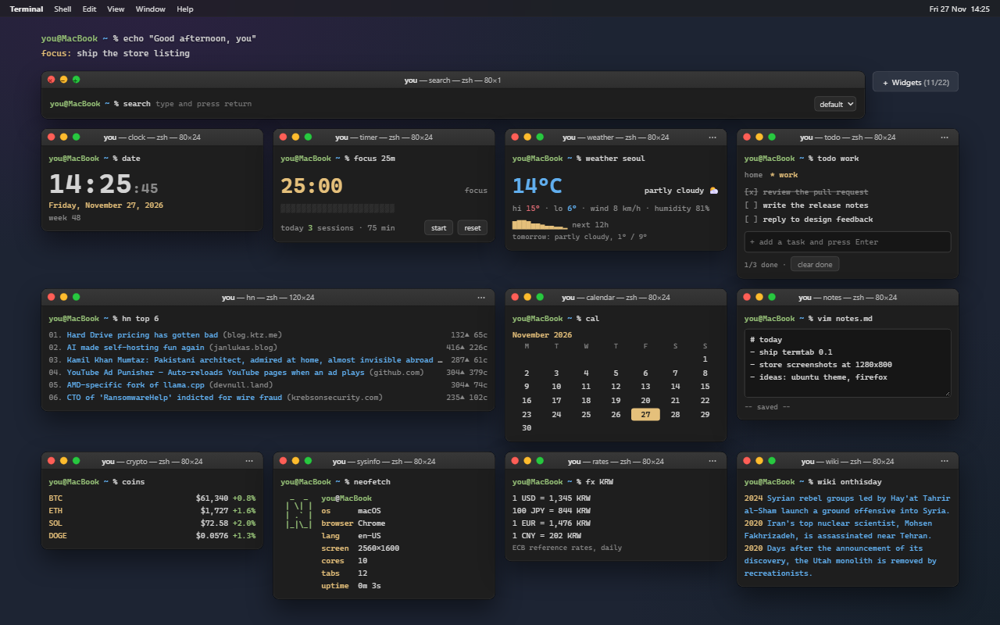

# termtab (working name)

**Your new tab, as a macOS Terminal — free, no permissions to fear.**

termtab is a Chrome extension that replaces the new tab page with a macOS desktop: a menu bar on top and every widget in its own Terminal window, with traffic lights that work, a `you — weather — zsh — 80×24` title and a zsh prompt line. Pick the widgets you want, drag windows to reorder them, and the layout is remembered.



Chrome Web Store: coming soon.

## Widgets

22 widgets in five groups. Add or remove them from **＋ Widgets**; each window's `⋯` opens its settings.

| Group | Widget | Data source |
|---|---|---|
| basics | Clock: big digits, date, ISO week | your computer |
| basics | Links: your own list of sites, with favicons | stored in the extension; icons from Google's favicon service |
| basics | Calculator: `bc`-style, keeps your last 5 results | your computer |
| basics | Search window (Google, DuckDuckGo, Naver, GitHub): always on above the grid, not a widget | the engine you pick, when you press Enter |
| focus | Focus timer: 25/5 pomodoro, today's count, shared across tabs | your computer |
| focus | To-do: several named lists (`todo work`, `todo home`) | stored in the extension |
| focus | Notes: a scratchpad that saves as you type | stored in the extension |
| focus | Habits: tick each day of this week | stored in the extension |
| focus | Countdown: days left until a date | stored in the extension |
| focus | Ambient sound: rain, café, white or brown noise, synthesized with Web Audio | your computer |
| focus | Workday: progress to the end of your workday, weekend aware | your computer |
| info | Weather: now, hi/lo, next 12 h, tomorrow | [Open-Meteo](https://open-meteo.com) |
| info | Calendar: this month, today highlighted | your computer |
| info | World clocks: other time zones, working hours in green | your computer |
| info | Exchange rates: ECB reference rates | [Frankfurter](https://frankfurter.dev) |
| info | Crypto prices with 24 h change | [CoinGecko](https://www.coingecko.com) |
| news | Hacker News top stories | Hacker News API |
| news | DEV top posts this week | DEV API |
| news | GitHub trending: most-starred repos created this week | GitHub search API |
| news | On this day | Wikimedia feed API |
| fun | System info, neofetch style | your browser |
| fun | Fortune: a programmer quote from a cow | bundled quotes |
| fun | System monitor, `htop`-style CPU and memory bars | `chrome.system.cpu`, `chrome.system.memory` |

Above the grid: a greeting and a "today's focus" line that clears each day.

**Focus mode:** while a focus session runs, the news windows minimize themselves and come back when the break starts (switch it off in Preferences).

## Everything is free

There is no paid tier and nothing is locked. Features other new-tab extensions charge for are free here: the pomodoro timer, several to-do lists, ambient sound, focus mode, world clocks and countdowns.

## Permissions

| Permission | Why |
|---|---|
| `storage` | Keeps your layout, settings and cached widget data on your device |
| `alarms` | Ends a focus session on time even when no new tab is open |
| `system.cpu`, `system.memory` | The System monitor widget's CPU and memory bars |

None of these shows a warning when you install. There are no host permissions: every data source allows requests from an extension page on its own.

## Privacy

No accounts, no analytics, no tracking. Everything stays in `chrome.storage.local` on your device. Widgets that fetch data send only what that request needs (a city's coordinates for weather, the coins you picked for crypto), only while the widget is on and a new tab is open. Details per widget: [PRIVACY.md](PRIVACY.md).

## Keyboard shortcuts

| Key | Action |
|---|---|
| `/` | Focus the search |
| `n` | Open notes |
| `t` | Start or pause the focus timer |
| `?` | Show the `man termtab` help window |
| `Esc` | Close windows, menus and the widget drawer |
| `Alt+←` / `Alt+→` | Move the focused window one place (on its title bar) |

## Install from source

1. Download or clone this repository.
2. Open `chrome://extensions` and switch on **Developer mode**.
3. Click **Load unpacked** and pick the repository folder.
4. Open a new tab.

## Development

No build step: plain Manifest V3 with ES modules. Node 20 or newer.

```sh
npm test              # unit tests (node --test)
npm run screenshots   # store screenshots of ?demo=1 into store/ (headless Edge, or set CHROME_PATH)
npm run package       # dist/termtab-<version>.zip for the Chrome Web Store
npm run icons         # icons/icon-*.png and store/promo-440x280.png from the SVG drawing
```

`npm run icons` needs `npm install` first (it uses `@resvg/resvg-js`); the other scripts have no dependencies. Open `newtab.html?demo=1` in the extension to see every online widget with bundled sample data.

## License

[MIT](LICENSE)

---

## 한국어

**새 탭을 macOS 터미널처럼. 전부 무료, 걱정할 권한도 없어요.**

termtab은 Chrome 새 탭을 macOS 데스크톱으로 바꿔 주는 확장 프로그램이에요. 시계, 집중 타이머, 할 일, 날씨, 뉴스 등 22개 위젯이 각각 터미널 윈도우로 열리고, 원하는 위젯만 골라 드래그로 배치할 수 있어요. 브라우저 언어가 한국어면 화면도 한국어로 나와요.

- 유료 플랜이 없어요. 뽀모도로, 여러 개의 할 일 목록, 배경 소리, 집중 모드, 세계 시계, 카운트다운까지 모두 무료예요.
- 계정, 분석, 추적이 없어요. 데이터는 내 기기의 `chrome.storage.local`에만 저장돼요. 자세한 내용은 [PRIVACY.md](PRIVACY.md)를 보세요.
- 설치할 때 권한 경고가 뜨지 않아요 (`storage`, `alarms`, `system.cpu`, `system.memory`).
